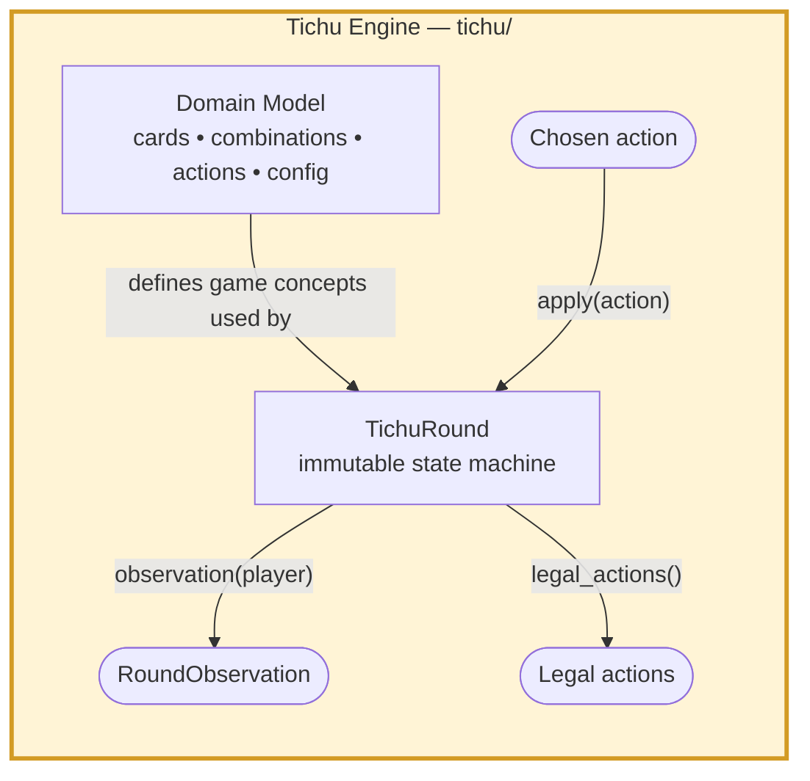
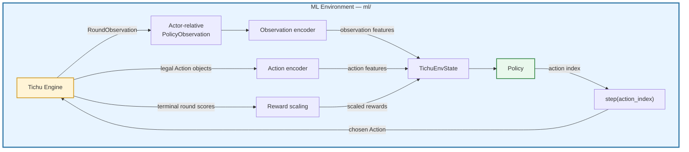
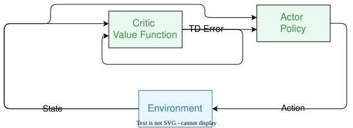

# tichu-agent
Repo to train and evaluate different reinforcement-learning approaches at playing the awesome card game Tichu.

## Game Engine
The game engine implements the [official Tichu Nanjing rules](https://scv.bu.edu/~aarondf/Games/Tichu/Tichu.html). It validates actions and produces a new immutable round state after every move.



The engine has the following configurable settings:
 - grand_tichu
 - small_tichu
 - card_exchange
 - bombs
 - out_of_turn_bombs
 - wishes
 - special_cards


#### API

```python
player = round_.current_player
observation = round_.observation(player)
legal_actions = round_.legal_actions()
action = agent.choose_action(observation, legal_actions)
round_ = round_.apply(action, legal_actions=legal_actions)
```

## ML Environment

`TichuEnv` turns engine state into actor-relative numeric features and maps a selected index back to a legal action.



#### API
```python
from ml import TichuEnv

env = TichuEnv(seed=0)
state = env.state()

assert state.policy_observation.current_player == 0

action_features = [candidate.features for candidate in state.encoded_actions]
state = env.step(action_index=0, legal_actions=state.legal_actions)
```

### Encoders
The `observation encoder` and `action encoder` encode the game engine round observations and legal actions into tensors. They are fully deterministic.

#### Observation Encoder
The observation feature tensor describes the current game situation. It has the fixed shape `[1169]` and is player-relative. It encodes only observable information. Each observation is encoded into a 1D vector with 1,169 feature values.

| Slice        | Size | Meaning                                            |
|--------------|-----:|----------------------------------------------------|
| `[0:56]`     | 56   | Observer's hand                                    |
| `[56:280]`   | 224  | Played cards: 4 players × 56 cards                 |
| `[280:504]`  | 224  | Captured cards: 4 players × 56 cards               |
| `[504:560]`  | 56   | Cards in the current trick                         |
| `[560:566]`  | 6    | Round phase                                        |
| `[566:571]`  | 5    | Current player: 4 players plus `None`              |
| `[571:575]`  | 4    | Dealer                                             |
| `[575:579]`  | 4    | Hand sizes                                         |
| `[579:586]`  | 7    | Game configuration flags                           |
| `[586:656]`  | 70   | Current top combination                            |
| `[656:661]`  | 5    | Player who played the top combination, plus `None` |
| `[661:662]`  | 1    | Consecutive passes                                 |
| `[662:682]`  | 20   | Bomb queue: 4 positions × player/`None`            |
| `[682:687]`  | 5    | Player resumed after a bomb, plus `None`           |
| `[687:690]`  | 3    | Bomb-close behavior                                |
| `[690:704]`  | 14   | Wish rank: `None` or ranks 2–14                    |
| `[704:708]`  | 4    | Finish position per player                         |
| `[708:712]`  | 4    | Tichu-call value per player                        |
| `[712:716]`  | 4    | Whether each player has played a card              |
| `[716:720]`  | 4    | Captured points per player                         |
| `[720:721]`  | 1    | Private-exchange information present               |
| `[721:945]`  | 224  | Exchange cards sent: 4 players × 56 cards          |
| `[945:1169]` | 224  | Exchange cards received: 4 players × 56 cards      |
| **Total**    | **1169** | **Observation feature vector**                  |

#### Action Encoder
The action observation feature tensor describes all legal actions. Its dimension depends on the amount of legal actions C, it has the shape [C, 376]. Each legal action is encoded in a 1D Vector. Multiple legal actions are stacked into a 2D-Matrix.

| Slice     | Size | Meaning                                  |
|-----------|------|------------------------------------------|
| [0:7]     | 7    | Action type                              |
| [7:63]    | 56   | Cards used by the action                 |
| [63:133]  | 70   | Combination representation               |
| [133:147] | 14   | Wish rank                                |
| [147:151] | 4    | Target player                            |
| [151:152] | 1    | Tichu decision value                     |
| [152:376] | 224  | Exchange transfers: 4 players × 56 cards |

### Rewards
When a round finishes the two team scores are converted into four player rewards. The default mode is `team_diff`:
```
difference = team_0_score - team_1_score

team_0_reward = difference / reward_scale
team_1_reward = -difference / reward_scale
```

### Policy
The policy is the rule that that selects the legal action given the current observation and current legal actions.

### Training
During a round, the trainer records every action taken by the learning players. After the round finishes, every transition receives its acting player’s terminal reward.

For every learner transition:

advantage = terminal_reward - predicted_value

Interpretation:

- Positive advantage: the result was better than the model expected.
- Negative advantage: the result was worse than expected.

The policy loss is:

policy_loss = -mean(log_probability * advantage)

Therefore:

- Positive advantage increases the probability of the selected action.
- Negative advantage decreases its probability.

The value head learns to predict the final reward:

value_loss = mean((predicted_value - terminal_reward)²)

The complete loss is:

total_loss = policy_loss + 0.5 * value_loss - entropy_weight * entropy

#### Training-round batching
During training-round batching transitions are collected over multiple complete rounds. Only one combined loss is calculated and one optimizer update is performed per batch:

```
advantages = returns - predicted_values
policy_loss = -(log_probabilities * advantages).mean()
value_loss = ((predicted_values - returns) ** 2).mean()
entropy = entropies.mean()
```

### Metrics


## Agents

### Random
Plays any random legal combination. Used as a baseline.

### Greedy
Deterministic baseline that declines Tichu calls, exchanges low cards, avoids bombs unless they finish the hand, and otherwise plays the cheapest useful legal combination.

### Heuristic
Deterministic rule-based baseline with hand-strength Tichu calls, partner-aware exchange/pass decisions, and conservative tactical bomb use.

### Actor-Critic
The model scores every currently legal action while also estimating the value of the current state.




## Scripts

### Run a simulation with random agents
```bash
python -m scripts.tichu_cli play --seed 10 --rounds 1 --verbose
```

Select agents per player:

```bash
python -m scripts.tichu_cli play --agents heuristic heuristic heuristic actor_critic:checkpoints/ac-1/actor_critic.pt
```


### Play from the Console

```bash
python -m scripts.tichu_cli console --seat 0 --agent actor_critic:checkpoints/ac-1/actor_critic.pt
```

This controls one human seat and assigns agents to the other three seats, including the human player's partner.


### Benchmark Agents
Benchmark two agents with paired rounds:

```bash
python -m scripts.benchmark_agents \
  --agent-a greedy \
  --agent-b actor_critic:checkpoints/ac-1/actor_critic.pt \
  --round-pairs 100 \
  --seed 100000 \
  --json results.json \
  --csv rounds.csv
```
Each round pair uses the same seed and dealer twice, swapping which team uses agent A and agent B. This reduces seat and deal bias. The summary includes confidence intervals for average score difference and round win rate.


### Train the Actor-Critic Agent
Train one shared actor-critic policy for one team against a fixed baseline:

```bash
python -m scripts.train_actor_critic \
  --opponent greedy \
  --rounds 1000 \
  --batch-rounds 8 \
  --learning-rate 1e-4 \
  --advantage-normalization batch \
  --entropy-bonus-weight 0.02 \
  --entropy-bonus-final-weight 0.002 \
  --checkpoint checkpoints/ac-2/actor_critic.latest.pt \
  --best-checkpoint checkpoints/ac-2/actor_critic.best.pt \
  --eval-every 100 \
  --eval-round-pairs 50 \
  --eval-seed 1000000 \
  --metrics-jsonl runs/ac-2/actor_critic.jsonl \
  --metrics-csv runs/ac-2/actor_critic.csv
```

Training seeds come from `--seed`; held-out evaluation seeds come from `--eval-seed`. Keep them separate so evaluation is not measured on training deals.

`--batch-rounds` controls how many complete rounds are accumulated before one optimizer update. Batch-level advantage normalization is the default and usually gives a less noisy policy gradient than updating after every single round.

`--checkpoint` is always the latest/final model. `--best-checkpoint` is updated only when held-out evaluation improves; if omitted while `--eval-every` is enabled, it defaults to `<checkpoint stem>.best<suffix>`.


### Plot Training Metrics
Plot training and held-out evaluation curves from one or more metrics files:

```bash
python -m scripts.plot_training_metrics \
  --metrics runs/actor_critic.csv \
  --out runs/plots
```

For run comparisons:

```bash
python -m scripts.plot_training_metrics \
  --metrics runs/test_a/actor_critic.csv runs/test_b/actor_critic.csv \
  --labels test_a test_b \
  --out runs/comparison_plots
```


## Future Improvement
- Rewards
  - reward discounting
  - gamma
  - temporal-difference bootstrapping
  - GAE
  - intermediate reward shaping
- Better History Awareness