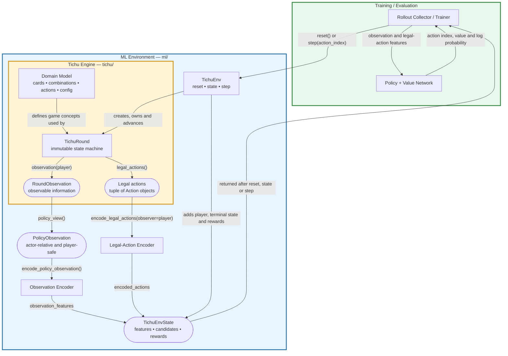

# tichu-ai

Repo to test different machine learning approaches at playing the card game Tichu.

## Game Engine
The [game engine](/tichu/) implements a standard four-player parnership tichu.

Agents or humans can connect using the following API:
```
player = round_.current_player
observation = round_.observation(player)
legal_actions = round_.legal_actions()
action = agent.choose_action(observation, legal_actions)
round_ = round_.apply(action)
```

#### Run a simulation with random agents
```bash
python -m scripts.tichu_cli play --seed 10 --rounds 1 --verbose
```

Select agents per player:

```bash
python -m scripts.tichu_cli play --agents random random greedy heuristic
```

Bomb combinations are enabled by default and follow normal turn order. Enable
standard Tichu-style interrupt windows explicitly:

```bash
python -m scripts.tichu_cli play --out-of-turn-bombs
```

#### Play from the console
```bash
python -m scripts.tichu_cli console --seat 0 --agent random
```

This controls one human seat and assigns agents to the other three seats,
including the human player's partner.

## RL Environment



`TichuEnv` exposes actor-relative policy observations and variable legal-action
features without exposing the underlying round or opponents' hands:

```python
from ml import TichuEnv

env = TichuEnv(seed=0)
state = env.state()

assert state.policy_observation.current_player == 0

action_features = [candidate.features for candidate in state.encoded_actions]
state = env.step(action_index=0)
```

Relative seats are ordered as the observer, next seat, partner, and previous
seat. Action targets use the same coordinates:
  - 0: self
  - 1: next player
  - 2: partner
  - 3: previous player
  
Full engine state remains available explicitly as `env.round` for diagnostics, but it is not part of the
policy-facing `TichuEnvState`.


## Agents

- `random`: random legal-action baseline.
- `greedy`: deterministic baseline that declines Tichu calls, exchanges low cards,
  avoids bombs unless they finish the hand, and otherwise plays the cheapest useful
  legal combination.
- `heuristic`: deterministic rule-based baseline with hand-strength Tichu calls,
  partner-aware exchange/pass decisions, and conservative tactical bomb use.

## Evaluation

Benchmark two agents with paired rounds:

```bash
python -m scripts.benchmark_agents --agent-a greedy --agent-b random --round-pairs 100 --json results.json --csv rounds.csv
```

Each round pair uses the same seed and dealer twice, swapping which team uses
agent A and agent B. This reduces seat and deal bias.
