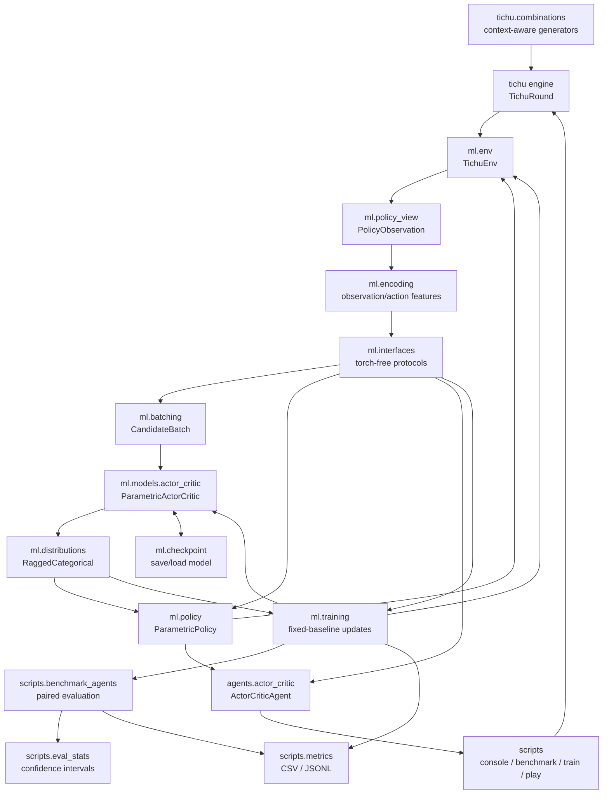
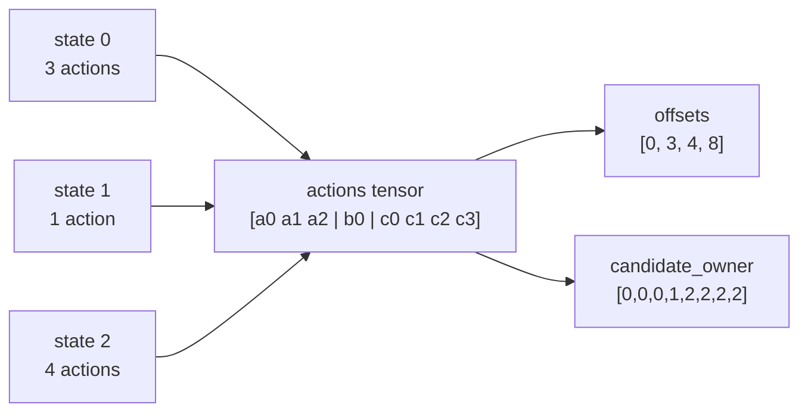
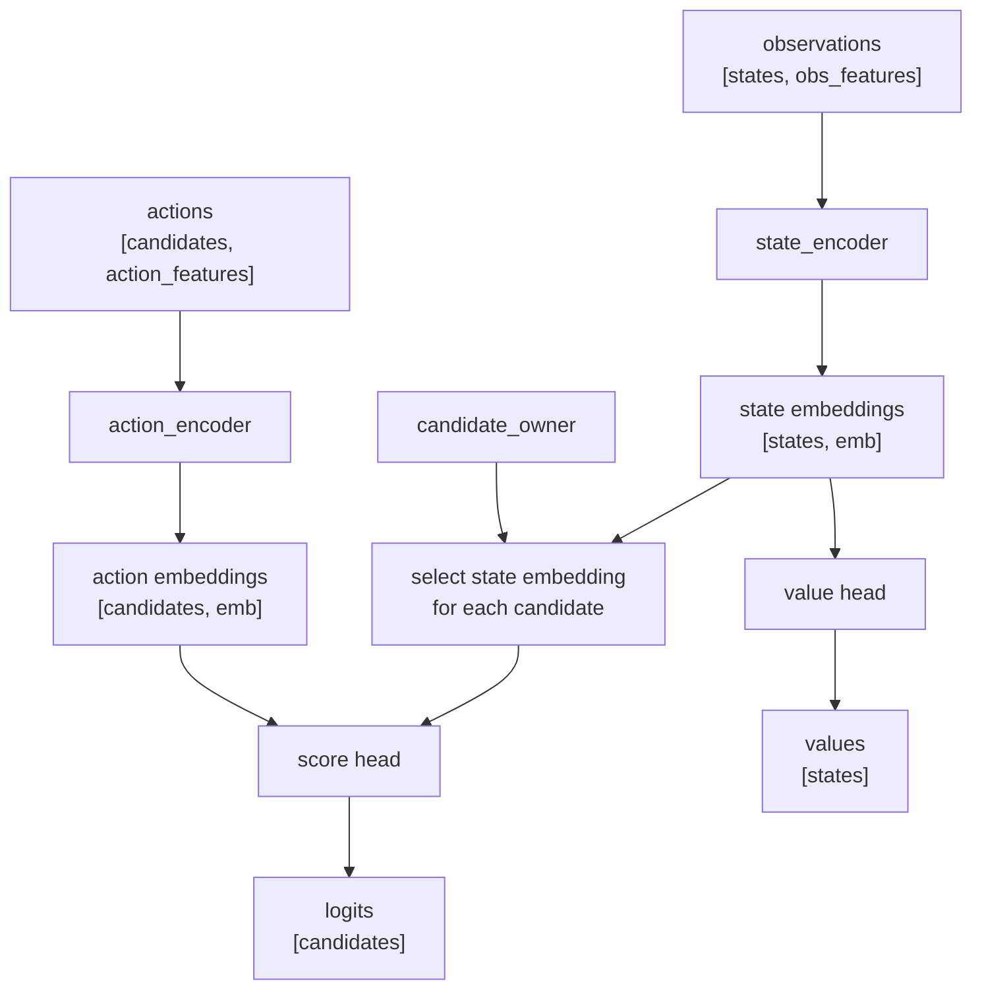
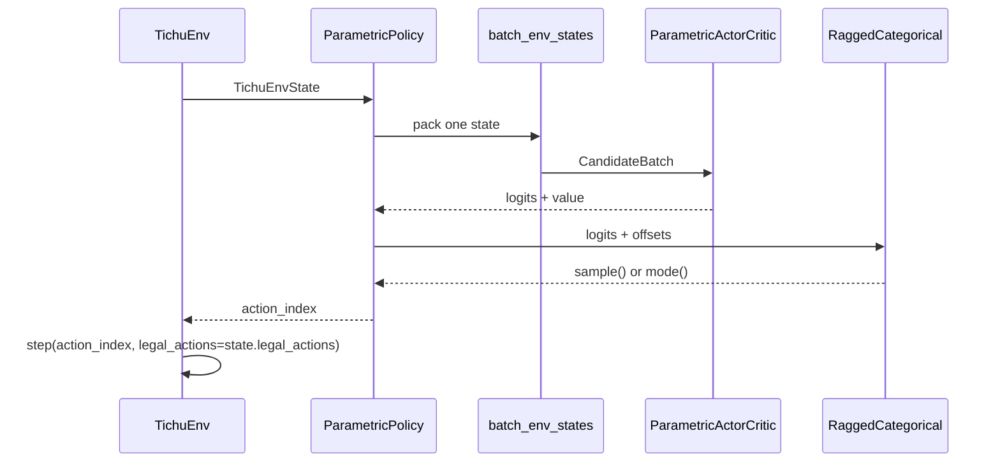
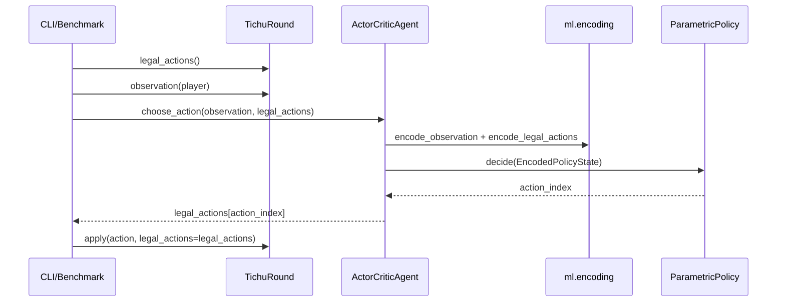
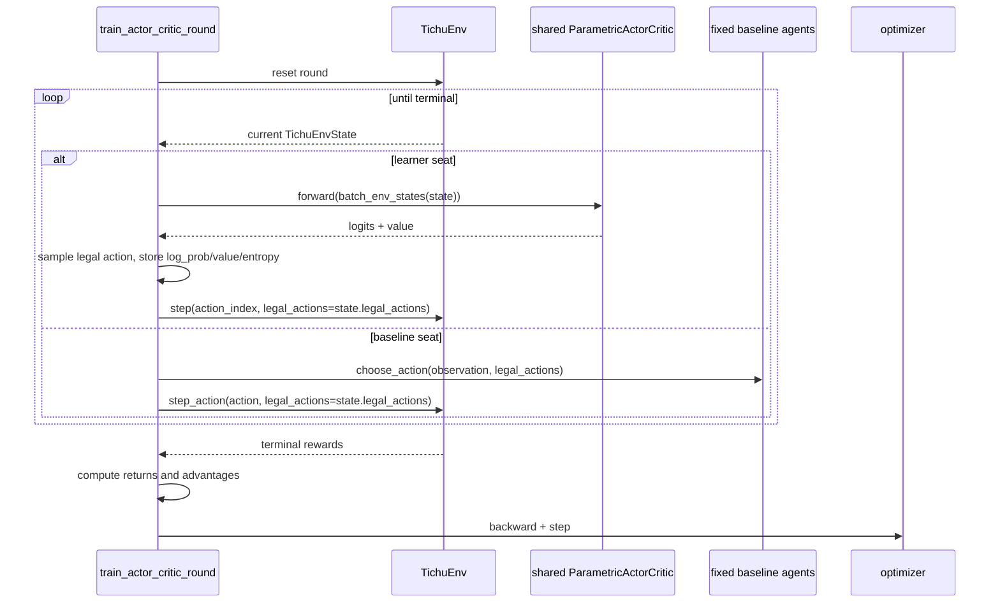
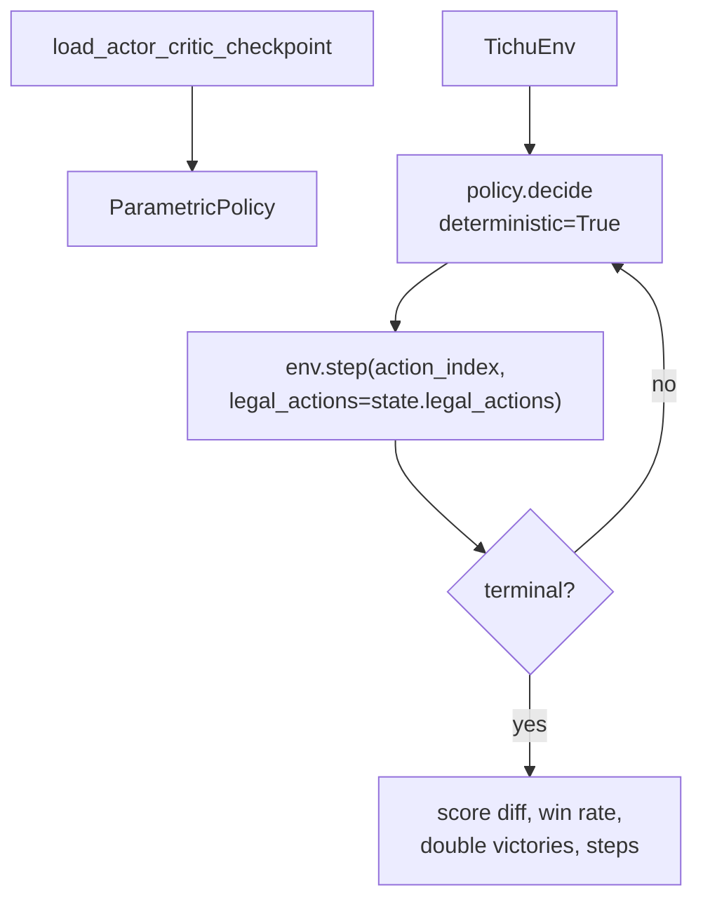

# ML Architecture

This project uses the game engine as the source of truth and puts ML-specific
logic in `ml/`. The model never invents raw moves. The engine creates legal
actions, the ML layer encodes them, and the model ranks those legal candidates.

## Core Terms

**Actor-critic** is a reinforcement-learning model with two outputs:

- **Actor**: chooses an action. Here it emits one score, called a logit, for
  each legal action candidate.
- **Critic**: estimates how good the current state is. Here it emits one scalar
  value per state.

The actor-critic model is not the full agent by itself. The deployable policy is:

```text
EncodedPolicyState + ParametricActorCritic + ParametricPolicy
```

`ParametricPolicy` is the inference adapter that turns model scores into a legal
action index. The shared policy-facing contracts live in `ml/interfaces.py` and
do not import torch.

**Ragged** means each state has a different number of legal actions. One player
might have 2 legal actions, another might have 2184. The implementation stores
all candidates in one flat tensor and uses offsets to recover each state's local
candidate group.

**Action ranking** means the model scores legal actions produced by the engine
instead of outputting a fixed global action ID. This avoids illegal model moves.

## Components



Main files:

- `tichu/combinations.py`: classifies card groups and provides context-aware
  generators. `TichuRound.legal_actions()` uses these generators to ask for only
  combinations relevant to the current top play, plus stronger bombs when bombs
  are enabled.
- `agents/actor_critic.py`: wraps an ML policy behind the public `Agent`
  interface used by scripts and benchmarks. It depends on torch-free ML
  interfaces, not on PyTorch.
- `ml/interfaces.py`: small shared protocols for encoded states, encoded action
  candidates, policy decisions, and inference policies.
- `ml/env.py`: ML-friendly wrapper around `TichuRound`.
- `ml/policy_view.py`: converts absolute player seats into observer-relative
  seats, where the acting player is always relative seat `0`.
- `ml/encoding.py`: converts observations and legal actions into float tuples.
- `ml/batching.py`: packs variable legal-action groups into tensors.
- `ml/models/actor_critic.py`: PyTorch actor-critic network.
- `ml/distributions.py`: categorical distribution over ragged legal-action
  groups.
- `ml/policy.py`: inference wrapper that returns a legal action index.
- `ml/training.py`: rollout collection and actor-critic updates against fixed
  baseline agents.
- `ml/checkpoint.py`: checkpoint save/load with schema compatibility checks.
- `scripts/eval_stats.py`: confidence intervals for score difference and win
  rate.
- `scripts/metrics.py`: CSV/JSONL metric writer for experiment logs.
- `scripts/benchmark_agents.py`: paired deterministic evaluation. It caches
  checkpoint-backed and stateless agents per benchmark run.
- `scripts/train_actor_critic.py`: command-line training entry point.

## Encoded Observations

`encode_observation()` first builds a `PolicyObservation`, then encodes it.
The policy view is player-relative: from the acting player's perspective,
relative player `0` is self, `1` is next player, `2` is partner, and `3` is
previous player.

The observation vector currently has `OBSERVATION_FEATURE_SIZE = 1169`.

It contains:

- own hand as a 56-card mask
- played cards per relative player
- captured cards per relative player
- current trick cards
- phase, current player, dealer
- hand sizes
- enabled game config flags
- top combination and top player
- pass count, bomb queue, bomb resume player, bomb-close behavior
- Mahjong wish
- finish order
- Tichu calls
- whether each player has played a card
- captured points
- private exchange information visible to the observer

Card IDs matter because every 56-card mask uses the canonical class ID as the
feature index. If `card_id = 26` is `dog`, then feature `26` means `dog`.

## Encoded Actions

`encode_legal_actions(actions, observer=player)` returns:

```python
tuple[EncodedAction, ...]
```

Each `EncodedAction` keeps both:

```python
action   # original engine Action object
features # tuple[float, ...]
```

The action vector currently has `ACTION_FEATURE_SIZE = 376`.

It contains:

- action type: grand Tichu, exchange, small Tichu, play, pass, bomb, dragon gift
- 56-card mask for cards involved in the action
- combination encoding, if the action has a combination
- Mahjong wish rank, if relevant
- target player, if relevant
- Tichu value signal
- exchange recipient-card matrix

The combination sub-vector has `COMBINATION_FEATURE_SIZE = 70`:

- 56-card mask
- combination kind
- present flag
- primary rank
- length
- Phoenix-present flag
- Phoenix-as rank

## Ragged Batches

Different states have different legal action counts. Instead of padding, the
batch stores candidates flat:



`CandidateBatch` contains:

- `observations`: `[num_states, observation_features]`
- `actions`: `[total_candidates, action_features]`
- `candidate_owner`: one state index per candidate
- `offsets`: group boundaries for each state's candidates

`RaggedCategorical` uses `offsets` so softmax, sampling, log-probability, and
entropy are computed independently inside each state's legal-action group.

## Model Forward Pass



The actor output is `logits`. Larger logits mean the model prefers that legal
action more. The critic output is `values`, one estimated return per state.

## Inference Policy

The policy is implemented in `ml/policy.py`.



Use:

```python
policy = ParametricPolicy(model)
decision = policy.decide(state, deterministic=True)
state = env.step(decision.action_index, legal_actions=state.legal_actions)
```

`deterministic=True` uses the highest-scoring legal action. `False` samples from
the categorical distribution, which is useful during training exploration.
Explicit torch random generators belong in lower-level training code, not in
the deployment-facing policy interface.

## Agent Adapter

`ActorCriticAgent` is implemented in `agents/actor_critic.py`.



Use a checkpoint-backed policy in existing scripts with:

```bash
python -m scripts.benchmark_agents --agent-a actor_critic:checkpoints/model.pt --agent-b heuristic
python -m scripts.tichu_cli console --agent actor_critic:checkpoints/model.pt
```

The CLI/benchmark registry requires a checkpoint path for `actor_critic`.
Programmatic code can still build `ActorCriticAgent.from_model(model)` when it
already owns a model instance.

## Rewards

Rewards are produced by `TichuEnv` only when a round terminates. Non-terminal
steps return zero rewards.

Reward modes:

- `team_diff`: team 0 receives `(score0 - score1) / reward_scale`; team 1
  receives the negative value.
- `team_score`: each team receives its own round score divided by
  `reward_scale`.

Player rewards are expanded by team:

```text
P0 and P2 use team 0 reward
P1 and P3 use team 1 reward
```

## Training Loop

The first implemented training setup uses one shared model for the learner team
and fixed baseline agents for the opposing team:

```text
P0/P2 = shared learner policy
P1/P3 = fixed random, greedy, or heuristic baseline
```

`ml/training.py` contains the reusable training code. `scripts/train_actor_critic.py`
is the CLI wrapper.



Typical losses:

```text
policy_loss = -log_probability * advantage
value_loss = (value - return)^2
entropy_bonus = entropy
total_loss = policy_loss + value_weight * value_loss - entropy_weight * entropy_bonus
```

The critic learns to predict future reward. The actor learns to increase the
probability of actions with positive advantage and decrease actions with
negative advantage.

Run a first baseline training job with:

```bash
python -m scripts.train_actor_critic \
  --opponent heuristic \
  --rounds 1000 \
  --checkpoint checkpoints/actor_critic.pt
```

Run the same training with periodic held-out evaluation and metrics:

```bash
python -m scripts.train_actor_critic \
  --opponent greedy \
  --rounds 1000 \
  --checkpoint checkpoints/actor_critic.pt \
  --eval-every 100 \
  --eval-round-pairs 50 \
  --eval-seed 1000000 \
  --metrics-jsonl runs/actor_critic.jsonl \
  --metrics-csv runs/actor_critic.csv
```

`--seed` controls training deals. `--eval-seed` controls evaluation deals and
should be kept outside the training seed range.

Useful early simplification while debugging training speed:

```bash
python -m scripts.train_actor_critic \
  --opponent greedy \
  --rounds 100 \
  --checkpoint checkpoints/actor_critic_fast.pt \
  --no-grand-tichu --no-small-tichu --no-exchange \
  --no-bombs --no-wishes --no-special-cards
```

## Evaluation Loop

Evaluation should run with deterministic policy decisions and no learning:



For project-level evaluation, `ActorCriticAgent` wraps `ParametricPolicy` behind
the same `Agent` interface as the rule-based baselines. Trained checkpoints can
be compared with the benchmark script against `random`, `greedy`, and
`heuristic` through the `actor_critic:/path/to/checkpoint.pt` agent spec.
Benchmark summaries include confidence intervals for mean score difference and
round win rate. The CLI loads checkpoint-backed agents through an `AgentCache`,
so each checkpoint spec is loaded once per benchmark run instead of once per
round.
